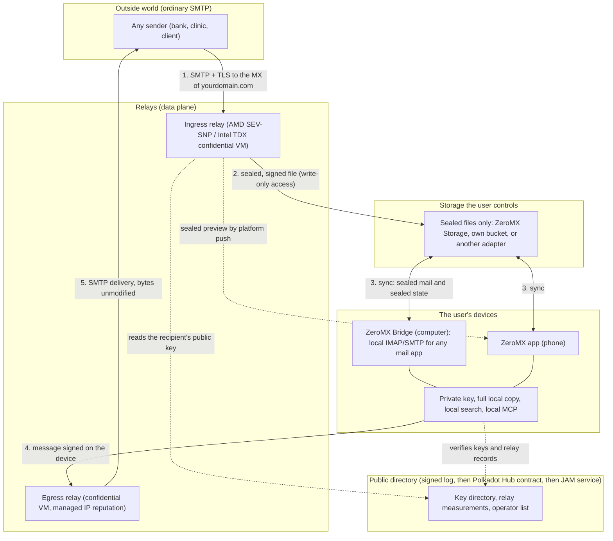
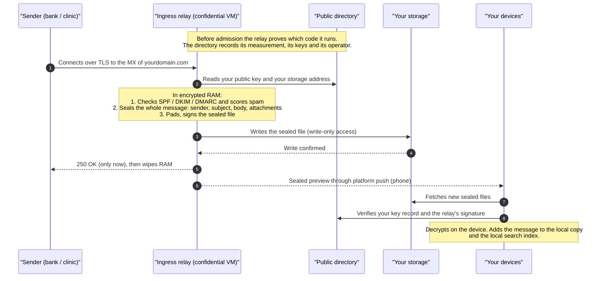

# 01 — System Architecture

> Read [07 — Threat Model, Trust Boundaries & Known Limits](07-threat-model-and-limits.md) alongside this document. It defines what the system protects, who is still trusted, and which claims are off limits.

## 1. Executive Summary & Core Thesis

**Email has sovereignty without privacy. Messengers have privacy without sovereignty. ZeroMX is built to give both.**

An address on your own domain is the last widely used identity that belongs to you: you can change provider and keep it, and anyone in the world can write to it without asking a platform for permission. What email never had is privacy. Whoever stores your mailbox can read all of it.

Email got here in three steps, and each one traded control for convenience:

1. **POP3.** The provider received mail and held it briefly. Your computer downloaded it and the mail lived with you. One device only.
2. **IMAP.** The mailbox moved to the server so several devices could see the same state. The server became the place your mail lives.
3. **Webmail.** The provider now owns the storage, the client, the search and the account. Your whole archive sits in readable form at one company.

Earlier attempts to fix this each broke something people were not willing to give up:

| Attempt | What it fixed | Why it stayed small |
| :--- | :--- | :--- |
| **PGP and S/MIME** | End-to-end content encryption | Both sides must set it up. Key management is manual. Sender, subject and the fact of the conversation stay visible. |
| **Encrypted providers** (Proton, Tuta) | The stored mailbox is encrypted | A new island: their storage, their apps, their format. A desktop mail app needs a paid bridge. You trust one company's servers and the web code it serves on each visit. |
| **Forwarders and aliases** | Hides your address | One company's servers read every message in passing. |
| **New protocols** (Dark Mail and others) | A clean design | They need both ends to move. Email's value is that the other end does not have to. |

**ZeroMX keeps the sync of step 3 and returns the ownership of step 1.** It has four parts, and each one can be replaced without changing your address:

- **Relays.** The mail servers the world sees for your domain. A relay receives a message, seals it to your public key inside an attested confidential VM, writes the sealed file to your storage, and keeps nothing.
- **Storage you control.** Sealed files live in storage you choose: ZeroMX Storage by default, or your own bucket. Whoever hosts it sees sealed files, their padded sizes and arrival times, and nothing else.
- **Your devices.** They hold the private key and a full local copy. They sync through the storage, decrypt locally, and search locally. On a computer, **ZeroMX Bridge** serves the mail to Apple Mail, Outlook, Thunderbird or another IMAP app. On a phone you use the ZeroMX app.
- **A public directory.** Public keys, relay measurements and the operator list live in a record nobody can quietly rewrite, including the ZeroMX team. It is deployed on Polkadot ([08](08-why-polkadot-jam.md)).

**What this does not do:** it does not hide mail from your correspondent's provider, and it does not make relay operators mathematically unable to read mail from outside senders. See [07, section 2](07-threat-model-and-limits.md).

**What changed from the first design.** The first design delivered sealed envelopes into the user's existing Gmail mailbox and decrypted them with a browser extension. It was dropped as the default in November 2026. The reasons are in [07, section 6](07-threat-model-and-limits.md). An existing IMAP mailbox remains available as an optional storage adapter (section 4).

---

## 2. Four Planes, Strictly Separated

> [!IMPORTANT]
> **Email bytes never enter the control plane.** The directory holds public keys, attestation results, operator records and quota accounting. No message, no sender, no subject and no per-message record goes on any chain.

> [!NOTE]
> **Privacy does not depend on a blockchain.** The sealing, the storage and the sync work with the directory deployed as a plain signed log. The chain is what stops anyone, including us, from rewriting the directory. See [08, section 2](08-why-polkadot-jam.md).

---

## 3. End-to-End Protocol Flows

### Flow A — Inbound from anyone (world -> your storage)

When a sender that knows nothing about ZeroMX writes to `you@yourdomain.com`:

- **The relay accepts a message only after the storage confirms the write.** If the storage is unreachable, the relay answers with a temporary SMTP error and the sender's server retries, as SMTP has always done, typically for several days. The relay needs no disk and no queue.
- **The relay cannot read or delete what is already stored.** Its access is write-only, to one drop prefix ([02, section 2.3](02-technical-specification.md)).
- Step 1 is only as safe as the sender's TLS validation. Every onboarded domain publishes MTA-STS and DANE records pinned to relay keys. See [07, section 5](07-threat-model-and-limits.md).

### Flow B — Sync between your devices

Nothing has to be online for mail to arrive, and devices never talk to each other.

1. **Messages are immutable.** A sealed message is written once and never modified.
2. **State is a sealed log.** Read and unread, flags, folders, labels, deletions and drafts are small operations that each device appends to its own sealed log in the storage. Devices merge all logs with a deterministic rule, so two devices that were offline reach the same result without conflicts.
3. **Every device keeps a full local copy** (phones may keep recent mail and fetch older bodies on demand). Reading and searching work offline.
4. **Wake-ups are opaque.** A relay sends devices a "something changed" hint. Devices that miss it catch up on the next poll.

The format is specified in [02, section 2](02-technical-specification.md).

### Flow C — Outbound to anyone

1. **You write in your mail app.** The Bridge listens on `127.0.0.1`. Drafts are sealed on the device before they are saved to storage, so no draft leaves the computer readable.
2. **The device signs.** The client signs with your domain's DKIM key, which was generated on the device. No relay ever holds a key that can sign as your domain.
3. **Quota token.** The client attaches a signed per-account quota token. Egress refuses to send without one. This keeps spammers off shared sending addresses.
4. **Egress.** The message is encrypted to an attested egress relay, which unwraps it in encrypted RAM, delivers the unmodified bytes over TLS to the recipient's MX, and wipes RAM.
5. **Sent copy.** The device seals a copy to your own key and writes it straight to storage.

The recipient's provider stores the recipient's copy the way it always does. That is their mailbox, not yours.

### Flow D — ZeroMX to ZeroMX (end to end)

When both sender and recipient have keys in the directory:

1. The sender's device finds the recipient's verified public key in the directory.
2. It encrypts the message **to that key before the message leaves the device**.
3. No relay holds the plaintext at any point. Confidentiality rests on the cipher suite and the two endpoints.

Stored mail has no forward secrecy: a stolen long-term key opens the messages of its key period. See [07, L5](07-threat-model-and-limits.md).

### Flow E — Arriving and leaving

- **Import.** A device reads the old mailbox over IMAP, seals each message locally and uploads it. The old provider already saw that mail. Import protects it from now on and from any future storage host.
- **Export.** Any device writes the local copy to Maildir or mbox at any time. No server takes part.
- **Change storage.** Point the directory record at a new bucket. A device re-uploads the sealed files. The address and the keys do not change.
- **Change relays.** Edit the `MX` records and the relay list in your directory record. Storage and keys do not change.
- **Leave.** Export, repoint `MX` to any mail provider, and delete the storage. Nothing about your address depended on ZeroMX.

---

## 4. Storage Options

All options hold the same sealed files. Only the host differs.

| Option | Who hosts it | Status | Notes |
| :--- | :--- | :--- | :--- |
| **ZeroMX Storage** (default) | ZeroMX, on commodity object storage | Alpha | Nothing to configure. Included in the subscription. ZeroMX cannot read it. |
| **Your own bucket** | Any S3-compatible service or a server you run (Cloudflare R2, Backblaze B2, AWS S3, MinIO on a NAS) | Alpha | You create the bucket and two credentials: write-only for relays, full access for your devices. |
| **File-sync services** | WebDAV, iCloud Drive, Dropbox, Google Drive | Later, if asked for | These are not built for many small files and need a user-side token. Lower priority. |
| **Existing IMAP mailbox** (compatibility mode) | Gmail, Outlook, Fastmail, any IMAP host | Later, if asked for | Sealed messages are delivered to the mailbox over SMTP and read over IMAP by the Bridge. The mailbox host can throttle or filter relay mail, which is why this is not the default. |
| **Polkadot Levity** (Bulletin Chain) | Polkadot's storage network | Experimental, after Levity mainnet | Suitable as an arrival box, not as the archive: retention is about two weeks unless renewed, and anyone can copy the ciphertext. See [08, section 5](08-why-polkadot-jam.md). |

---

## 5. Clients

| Client | Where | Status | What it is |
| :--- | :--- | :--- | :--- |
| **ZeroMX Bridge** | macOS, Linux, then Windows | Alpha | A local IMAP/SMTP server on `127.0.0.1` in front of the local copy. Apple Mail, Outlook, Thunderbird and other IMAP apps connect to it. Spark is under test ([04, risks](04-roadmap.md)). |
| **ZeroMX app** | iOS, then Android | Public beta | A native mail app. The relay seals a short preview to a device key and sends it through the platform push service, so notifications show the real sender and subject. iOS does not let an app run a local mail server in the background, so the iPhone's built-in Mail app cannot be used. |
| **`zeromx-mcp`** | Computer | Public beta | A local Model Context Protocol server over the local copy, for the user's own AI agents. |
| **Web client** | Any browser | Open network phase | Shipped only where the code is pinned: as a Polkadot Product, whose bundle is the one recorded on-chain under its name, or as an installed app. A web page that decrypts mail is otherwise only as trustworthy as whoever serves it on each visit. |
| **Polkadot Product** | Polkadot Desktop, Polkadot App, Polkadot Web | Spike in alpha, then beta | The same account inside the Polkadot hosts, for people who already use them. A showcase and one more client, never a requirement. |

The protocol is open. A third party can write a client or a storage adapter without permission.

---

## 6. Relay Operators & Assurance Tiers

### Who runs relays

| Stage | Who | What the user is told |
| :--- | :--- | :--- |
| **Alpha** | The ZeroMX team | "The team runs the relays." |
| **Open network** | Vetted independent operators with a public identity, verified hardware they cannot physically reach, and a bond in DOT. They are paid from subscriptions. | The user lists two or three operators for their domain. |
| **Split trust** | Anyone, in pairs | Opened only when no single operator holds a whole message (Tier 3). |

Anyone can already run the open-source relay for their own domain.

### Why operator roles are split (port 25 reality)

| Role | Requirements | Admission and economics |
| :--- | :--- | :--- |
| **Ingress** | Static datacenter IP with port 25 open. AMD SEV-SNP or Intel TDX confidential VM. **No physical access to the host** (cloud or colocation with attestation-of-location). | Users list several independent operators in `MX` priorities. SMTP retry gives availability if one is down. |
| **Egress** | Warm, clean IP ranges with good standing at major receivers. Confidential VM. Same no-physical-access rule. | Higher bond. Per-account quota tokens protect IP reputation. Abuse reports revoke the offending account. |

Operators cannot be permissionless while a single machine holds plaintext: confidential-computing hardware does not defend against an operator with physical access. See [07, section 4](07-threat-model-and-limits.md).

### What attestation does and does not establish

Ordinary SMTP ends TLS at the receiving `MX`, so on a normal server the administrator can dump RAM. ZeroMX defines **three assurance tiers**:

1. **Tier 1 — End to end (`ZeroMX <-> ZeroMX`):**
   - **Mechanism:** device-to-device hybrid `HPKE` encryption before transmission. Keys are authenticated through the directory.
   - **Trust:** the endpoints, the cipher suite, the directory's transparency guarantees, and the client software.
2. **Tier 2 — Attested confidential hardware (mail from everyone else, default):**
   - **Mechanism:** RAM is encrypted by the CPU (`AMD SEV-SNP` / `Intel TDX`). The VM generates its TLS and signing keys internally and produces a quote binding them to the measurement of a reproducible open-source image with no disk and no logging. The measurement and the vendor certificate chain are verified before the relay is admitted.
   - **Establishes:** which code booted, on genuine silicon, and that the operator has no software path to the plaintext.
   - **Does not establish:** that nobody read the mail. It assumes the CPU vendor is honest and that nobody with physical access has attacked the machine.
3. **Tier 3 — Split-trust ingress (`2PC-TLS`, high-risk domains):**
   - **Mechanism:** the inbound TLS session key is secret-shared across **two operators on different silicon** (one Intel TDX, one AMD SEV-SNP). Neither holds the full session key.
   - **Trust:** breaking it requires compromising both operators and both vendors at once. This tier is the precondition for opening the operator set.

---

## 7. What Polkadot Is Used For

ZeroMX talks to Polkadot's public networks directly. It does not need the Polkadot app.

| Piece | Use in ZeroMX |
| :--- | :--- |
| **Contract on Polkadot Hub, later a JAM service** | The key directory, relay measurements and operator list. Nobody can rewrite it, and every change is public. |
| **`.dot` name** | A human-readable handle that points to a key record, and the on-chain record that pins the code of the ZeroMX Product. It is not an email domain. |
| **Proof of Personhood** | One free tier per person, and outbound anti-abuse without a payment. Whether it can be obtained without the Polkadot app is unverified. |
| **dotUSD and DOT** | Optional payment, operator bonds, and optional stake instead of a subscription. |
| **Polkadot hosts** (Desktop, App, Web) | A place where the ZeroMX Product can be found and used. |

The relay, the sealed format and the storage adapters do not depend on any of these. The full reasoning, including what is unverified, is in [08](08-why-polkadot-jam.md).

---

## 8. UX Gap Matrix (User-Visible Friction & Design Answers)

| # | User-visible friction | Root cause | Design answer |
| :- | :--- | :--- | :--- |
| **1** | **It is a new mailbox.** Mail no longer lives in Gmail or Outlook.com. | Sovereign storage means the old provider stops being the store. | Import over IMAP on the device. The address does not change for people who already use their own domain. On a computer the mail app stays the same. |
| **2** | **Webmail users have no tab to open at first.** | A web page that decrypts mail must have pinned code. | Any free desktop mail app through the Bridge from the alpha. The pinned web client comes in the open network phase. The waitlist measures how many people read mail only in a browser. |
| **3** | **Phone.** The phone's built-in mail app cannot read sealed mail. | iOS does not allow a background local mail server. | The **ZeroMX app**, with sealed push previews that show the real sender and subject. This *is* a separate app on the phone, and the product says so. There is no phone app in the alpha. |
| **4** | **Mail-app cloud features stop working.** Vendor push, Send Later, shared inboxes and vendor AI run on the vendor's servers. | Those servers cannot reach `127.0.0.1`, and would see only sealed mail if they could. | Stated at setup. For apps whose servers hold mailbox credentials, this is a privacy gain. |
| **5** | **Server-side search is gone.** | The storage holds sealed files. | Search runs on the device over the local copy, with **Gmail-style operators** (`from:`, `subject:`, `has:attachment`, `before:`, `label:`…). Most desktop mail apps also search their own cache. Search inside attachment content and OCR come later. |
| **6** | **Cloud AI assistants cannot read the mailbox.** | They would need the plaintext. | **`zeromx-mcp`** exposes the local copy to the user's own agents, on the user's machine, with per-tool consent. |
| **7** | **Spam filtering** is weaker than a large provider's. | A large provider learns from billions of mailboxes. | The relay checks `SPF`/`DKIM`/`DMARC` and scores before sealing. Devices add local filtering on decrypted mail. **Per-sender aliases** (`bank@`, `shop-x@` on a catch-all domain) let users cut off a leaking address. |
| **8** | **Calendar invites (`.ics`)** are not auto-added by a cloud service. | Cloud parsers cannot read sealed attachments. | Desktop mail apps handle invites themselves from the decrypted message. The ZeroMX app parses `text/calendar` parts and offers a one-click add. |
| **9** | **Owning a custom domain.** | Most people do not have one. | Onboarding registers one at a registrar in the user's own name, or connects an existing one. A trial address on a shared domain is planned for the beta, with its limit stated ([07, L9](07-threat-model-and-limits.md)). |
| **10** | **Losing every device.** | The key lives only on devices. | A printed recovery kit and device pairing. Without the kit or another device, nobody can recover the mail, including ZeroMX. |
| **11** | **Mail still sent to an old `@gmail.com` address.** | It resolves to the old provider's servers. | Guided change of address account by account. Forwarding from the old address works, and the old provider still sees what it forwards. |
