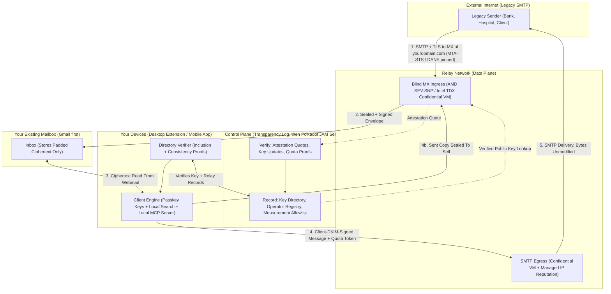

# 01 — System Architecture

> Read [07 — Threat Model, Trust Boundaries & Known Limits](07-threat-model-and-limits.md) alongside this document. It defines what the system protects, who is still trusted, and which claims are off limits.

## 1. Executive Summary & Core Thesis

Privacy-focused email providers (e.g., Proton Mail, Tuta) suffer from a structural adoption barrier: **the Island Effect**. Even privacy-conscious people drift back to Gmail or Outlook because:

1. **Habit and tooling:** years of filters, labels, shortcuts, integrations, and muscle memory live in the existing webmail.
2. **Multi-inbox fatigue:** a separate encrypted mail app on desktop is one more inbox to check.
3. **Ecosystem and AI friction:** siloed encrypted providers break automation pipelines and **Model Context Protocol (MCP)** integrations.
4. **Negative value perception:** users pay $5–$12/month for *more* friction while already owning free or subsidized cloud storage.
5. **Identity lock-in (B2B only):** companies cannot leave Google Workspace or Microsoft 365 because those accounts are the Identity Provider for every other tool. This matters for the enterprise gateway, not for the individual product.

A **centralized SaaS encryption proxy** in front of Gmail or Outlook only moves the trust: the proxy company sees all inbound and outbound mail in plaintext RAM.

**ZeroMX addresses both sides:**
- **Your mailbox becomes a ciphertext store.** Mail sent to your custom domain (`@yourdomain.com`) is sealed to your key before it reaches your mailbox provider. The first supported vault is **Gmail on desktop Chrome**. Desktop mail apps (Apple Mail, Spark, Outlook, Thunderbird) connect through **ZeroMX Bridge**, a local IMAP/SMTP proxy, from the public beta. Outlook web, iCloud, Fastmail and generic IMAP vaults follow.
- **The relay is constrained, not trusted blindly.** **Blind MX Relays** run in attested **confidential VMs** whose measurements, keys, and operators are recorded in a public control plane, designed to run as a **Polkadot JAM Service**. Trust is minimized and every remaining trust point is named in [07](07-threat-model-and-limits.md).

**What this does not do:** it does not hide mail from your correspondent's provider, and it does not make relay operators mathematically unable to read legacy mail. See [07, section 2](07-threat-model-and-limits.md).

---

## 2. Strict Separation: Data Plane vs. Control Plane

> [!IMPORTANT]
> **Plaintext email bytes never enter the control plane.** JAM validators and the Data Availability layer must inspect `Refine` work-package inputs, so sending email into JAM would leak it to validators. The control plane only handles keys, attestations, operator records, and quota accounting.

> [!NOTE]
> **JAM is not on the critical path for the first releases.** JAM is not yet live on mainnet and has no light client. v0 and v1 use a witnessed append-only transparency log with the same data model, then migrate to a JAM service. See [07, section 7](07-threat-model-and-limits.md).



---

## 3. End-to-End Protocol Flows

### Flow A — Inbound Legacy SMTP (World -> Your Mailbox)

When an external sender who knows nothing about ZeroMX (e.g., a hospital or bank) sends an email to `contact@yourdomain.com`:

```mermaid
sequenceDiagram
    autonumber
    participant S as "Legacy Sender (Bank / Hospital)"
    participant TEE as "Blind MX (Confidential VM)"
    participant CP as "Control Plane"
    participant Box as "Gmail (Ciphertext Store)"
    participant U as "Your Client (Extension / App)"

    Note over TEE,CP: Pre-registration: the CPU signs the binary measurement and the VM-born TLS + signing keys.<br/>The control plane verifies the quote and the operator's admission record.

    S->>TEE: Connects over TLS to the MX of yourdomain.com
    TEE->>CP: Reads verified public key for yourdomain.com
    Note over TEE: In encrypted RAM:<br/>1. Validates SPF/DKIM/DMARC + spam score<br/>2. Seals real From, Subject, Body, Attachments<br/>3. Pseudonymizes Message-ID / References<br/>4. Pads (Padmé), signs envelope, zeroes RAM
    TEE->>Box: Delivers opaque MIME (From: relay-3d@..., Subject: 🔒 Thread #a72f91)
    TEE-->>U: Sealed notification preview via platform push (mobile)
    Note over Box: The provider threads the conversation<br/>without sender identity, subject, or body.
    Box->>U: Ciphertext shown in webmail
    U->>CP: Verifies key record + relay signature
    Note over U: Passkey (WebAuthn PRF) unlocks the private key.<br/>UI renders real sender/subject/body in an isolated frame,<br/>updates the local index, exposes it to the Local MCP server.
```

Step 1 is only as safe as the sender's TLS validation. Every onboarded domain publishes MTA-STS and DANE records pinned to relay keys. See [07, section 5](07-threat-model-and-limits.md).

**Where the mail lives.** The relay never delivers to a device. It seals the message and delivers it to the mailbox over SMTP, like any other mail server. The mailbox is both the store and the sync point: every device reads from it, the extension through the open webmail session, the Bridge over IMAP, the phone app through the provider API. No device has to be online to receive mail, and there is no ZeroMX cloud copy and no device-to-device sync.

### Flow B — Outbound Reply Without Draft or Sent Leaks

Typing inside Gmail's native compose box uploads plaintext drafts every few seconds. ZeroMX prevents both draft and Sent-folder leaks:

1. **Isolated composer.** Clicking *Reply* opens a composer inside a cross-origin **extension frame** (`chrome-extension://…`). The webmail page's scripts cannot read it. A Shadow DOM alone is not a security boundary and is used only for styling the mount point. Drafts are sealed locally to the user's own key.
2. **Client-side DKIM.** The client signs the message with the domain's DKIM key, which was generated on the device. The relay never holds a key that could forge mail from your domain.
3. **Quota token.** The client attaches a signed per-account quota token. The egress relay checks it and refuses to send without one. (Anonymous zero-knowledge rate limiting replaces this in the permissionless phase.)
4. **Egress dispatch.** The message is encrypted to an attested egress relay, which unwraps it in encrypted RAM, delivers the unmodified bytes over TLS to the recipient's MX, and wipes RAM.
5. **Sent copy to self.** The client seals a copy to its own key and submits it through ingress. It arrives in the mailbox like any inbound envelope and threads through the pseudonymous `References` chain. **No mailbox API permission is required.**

### Flow C — Native `ZeroMX <-> ZeroMX` (End-to-End)

When both sender (`@alice-domain.com`) and recipient (`@bob-domain.com`) have keys in the directory:
1. Alice's client finds Bob's verified public key in the directory.
2. Alice's client encrypts the message **directly to Bob's key before it leaves her device**.
3. No relay CPU ever holds the plaintext. Confidentiality rests on the cipher suite and on the two endpoints, not on hardware or operators.

There is no forward secrecy for stored mail: a stolen long-term key opens archived messages for its key epoch. See [07, L5](07-threat-model-and-limits.md).

---

## 4. Relay Operators & Assurance Tiers

### Why Operator Roles Are Split (Port 25 Reality)

| Role | Requirements | Admission and economics |
| :--- | :--- | :--- |
| **Blind MX Ingress** | Static datacenter IP with port 25 open. AMD SEV-SNP or Intel TDX confidential VM. **No physical access to the host** (cloud or colocation with attestation-of-location). | Run by the ZeroMX team at launch, then by vetted, publicly listed operators. Users list several independent operators in `MX` priorities. SMTP retry gives availability if one is down. |
| **SMTP Egress** | Warm, clean IP ranges with good standing at major receivers. Confidential VM. Same no-physical-access rule. | Higher bond. Per-account quota tokens protect IP reputation. Abuse reports revoke the offending account. |

Operators cannot be permissionless while a single machine holds plaintext: confidential-computing hardware does not defend against an operator with physical access. See [07, section 4](07-threat-model-and-limits.md).

### What Attestation Does and Does Not Establish

Legacy SMTP ends TLS at the receiving `MX`, so on an ordinary server the host administrator can dump RAM. ZeroMX defines **three assurance tiers**:

1. **Tier 1 — Native end-to-end (`ZeroMX <-> ZeroMX`):**
   - **Mechanism:** client-to-client hybrid `HPKE` encryption before transmission. Keys are authenticated through the directory.
   - **Trust:** the endpoints, the cipher suite, the key directory's transparency guarantees, and the client software.
2. **Tier 2 — Attested confidential hardware (`Legacy -> ZeroMX`, default):**
   - **Mechanism:** RAM is encrypted by the CPU (`AMD SEV-SNP` / `Intel TDX`). The VM generates its TLS and signing keys internally and produces a quote binding them to the measurement of a reproducible open-source image with no disk or logging. The control plane verifies the vendor certificate chain and the measurement before admitting the relay.
   - **Establishes:** which code booted, on genuine silicon, and that the operator has no software path to the plaintext.
   - **Does not establish:** that nobody read the mail. It assumes the CPU vendor is honest and that nobody with physical access has attacked the machine.
3. **Tier 3 — Split-trust ingress (`2PC-TLS`, high-risk domains):**
   - **Mechanism:** the inbound TLS session key is secret-shared across **two operators on different silicon** (e.g., one Intel TDX, one AMD SEV-SNP). Neither holds the full session key.
   - **Trust:** breaking it requires compromising both operators and both vendors at once. This tier is the precondition for opening the operator set.

---

## 5. UX Gap Matrix (User-Visible Friction & Design Answers)

| # | User-Visible Friction | Root Cause | Design Answer |
| :- | :--- | :--- | :--- |
| **1** | **Phone.** The official Gmail/Outlook apps show `🔒 Thread #a72f91` and ciphertext. | Mobile platforms do not allow extensions inside other vendors' apps. | A **native ZeroMX mobile app**. The ingress relay seals a short preview to a device-bound notification key and sends it through the platform push service, so notifications show the real sender and subject. Users mute the provider app's notifications for the vault label. This *is* a second app on the phone, and the product says so. |
| **2** | **Server-side search goes blind.** | The provider holds only ciphertext. | The client keeps an encrypted local **SQLite (`FTS5`)** index and accepts **Gmail-style operators** (`from:`, `subject:`, `has:attachment`, `before:`, `label:`…). In the browser the index syncs across devices as encrypted blobs. Each Bridge builds its own index from IMAP, so desktops need no sync. Mail received before ZeroMX stays plaintext in the provider and keeps its server-side search. Searching inside attachment content and OCR come later. Indexing the full archive needs read access to the mailbox (see row 7). |
| **3** | **Calendar invites (`.ics`)** stop auto-adding. | Cloud parsers cannot read encrypted attachments. | The client parses decrypted `text/calendar` parts and offers a one-click add. |
| **4** | **Cloud AI assistants break.** | Cloud LLMs see ciphertext. | A **Local MCP server (`zeromx-mcp`)** reads the local decrypted index for the user's own agents. |
| **5** | **Spam filtering** cannot run after encryption. | Provider filters see uniform ciphertext. | The relay runs `SPF`/`DKIM`/`DMARC` and scoring before sealing and tags the outer envelope. This is weaker than a large provider's filter. **Per-sender aliases** (`bank@`, `shop-x@` on a catch-all domain) let users cut off a leaking address. |
| **6** | **Mail to the legacy `@gmail.com` address** reaches the provider first. | It resolves to the provider's MX. | Guided migration of accounts to the custom-domain address. The at-rest sweeper is optional hygiene. |
| **7** | **Mailbox API access is gated by the provider.** | Reading the full archive or writing to folders needs restricted OAuth scopes and a yearly security assessment that the provider controls. | Read, reply, and sent copies work **without any mailbox API** (webmail DOM plus sent-to-self). Full-archive indexing is an opt-in that uses the API or IMAP, and is budgeted as a gating item. |
| **8** | **Owning a custom domain.** | Most people do not have one. | Onboarding registers one for the user at a registrar in the user's own name, or connects an existing one. |
| **9** | **Desktop mail apps** (Apple Mail, Spark, Outlook, Thunderbird) show sealed envelopes. | They cannot run a browser extension, and most have no plugin API. | **ZeroMX Bridge**, a local IMAP/SMTP proxy on `127.0.0.1` that decrypts on the way in and seals on the way out ([02, section 4.4](02-technical-specification.md)). The mail app's own cloud features (vendor push, Send Later, shared inbox, vendor AI) stop working for that account, because the vendor's servers can only reach sealed mail. The account works only on computers that run the Bridge. |
