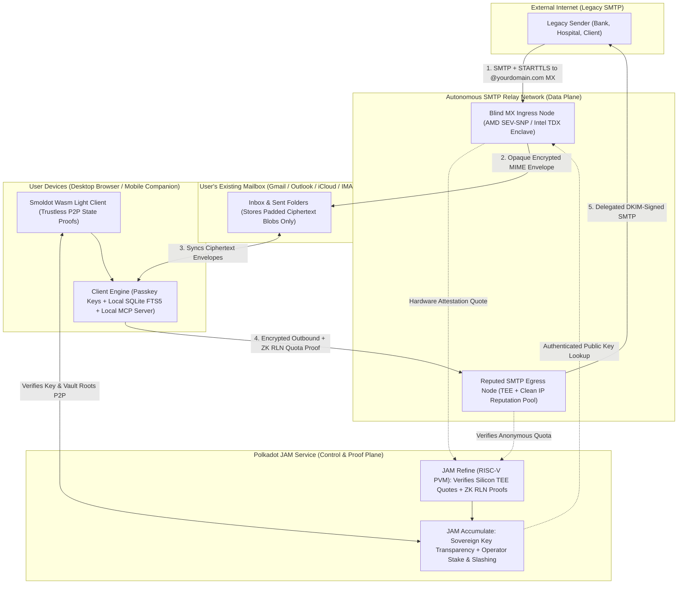

# 01 — System Architecture

## 1. Executive Summary & Core Thesis

Privacy-focused email providers (e.g., Proton Mail, Tuta) suffer from a structural adoption barrier: **the Island Effect**. Even privacy-conscious professionals frequently churn back to Google Workspace or Microsoft 365 because:

1. **Identity Lock-in (IdP / SSO):** Corporate accounts on Google or Microsoft act as the federated Identity Provider across dozens of SaaS tools and cannot be abandoned.
2. **Multi-Inbox Fatigue:** Running a separate encrypted email app on desktop and mobile creates daily friction ("yet another inbox to check").
3. **Ecosystem & AI Friction:** Siloed encrypted providers break standard OAuth workflows, automation pipelines, and emerging **Model Context Protocol (MCP)** integrations.
4. **Negative Value Perception:** Users pay $5–$12/month to experience *more* friction while already owning free or corporate-subsidized cloud storage.

At the same time, placing a **centralized SaaS encryption proxy** in front of Gmail or Outlook fails the sovereignty test: users merely trade trust in Google/Microsoft for trust in a smaller proxy company that sees all inbound and outbound mail in plaintext RAM.

**ZeroMX solves both sides simultaneously:**
- **Universal Provider Compatibility:** Any existing mailbox (**Gmail, Google Workspace, Outlook / Microsoft 365, iCloud Mail, Fastmail, or generic IMAP**) becomes a **dumb, free ciphertext store**. The user's only prerequisite is owning a custom domain (`@yourdomain.com`).
- **Decentralized Zero-Trust Infrastructure:** Autonomous **Blind MX Relays** run inside hardware-encrypted **Trusted Execution Environments (TEEs)** whose binary measurements, TLS keys, staking bonds, and anti-spam proofs are verified on-chain by a **Polkadot JAM Service** (RISC-V PVM), verified client-side via an embedded **Smoldot** P2P light client.

---

## 2. Strict Separation: Data Plane vs. Polkadot JAM Control Plane

> [!IMPORTANT]
> **Plaintext email bytes NEVER enter Polkadot JAM.** Because JAM validators auditing a core (`Guarantee` / `Assure` / `Audit`) and the Data Availability (DA) grid must inspect `Refine` work-package inputs for deterministic verification, sending raw emails into JAM would leak plaintext to validators. Instead, JAM acts strictly as the **cryptographic control, attestation, identity, and anti-spam verification plane**.



---

## 3. End-to-End Protocol Flows

### Flow A — Inbound Legacy SMTP (World -> Your Gmail / Outlook)

When an external sender who knows nothing about ZeroMX (e.g., a hospital or bank) sends an email to `contact@yourdomain.com`:

```mermaid
sequenceDiagram
    autonumber
    participant S as "Legacy Sender (Bank / Hospital)"
    participant TEE as "Autonomous Blind MX (TEE Enclave)"
    participant JAM as "Polkadot JAM (PVM)"
    participant Box as "Gmail / Outlook (Blind Disk)"
    participant U as "User Client (Browser / App)"

    Note over TEE,JAM: Pre-registration: CPU silicon signs binary measurement + enclave TLS pubkey.<br/>JAM Refine verifies AMD/Intel hardware quote and activates node stake.

    S->>TEE: Connects over TLS to MX of @yourdomain.com
    TEE->>JAM: Reads certified HPKE/PGP public key for @yourdomain.com
    Note over TEE: In encrypted RAM (~3ms):<br/>1. Validates SPF/DKIM/DMARC + Rspamd score<br/>2. Seals real From, Subject, Body & Attachments<br/>3. Pads to fixed bucket & zeroes RAM
    TEE->>Box: Delivers opaque MIME (From: relay-3d@..., Subject: 🔒 Thread #a72f91)
    Note over Box: Google/Microsoft threads conversation cleanly<br/>without knowing sender identity, subject, or body.
    Box->>U: Fetches encrypted message blob
    U->>JAM: Smoldot verifies key transparency root P2P
    Note over U: Passkey (WebAuthn PRF) unlocks private key;<br/>UI renders real sender/subject/body inline,<br/>updates local SQLite FTS5 & exposes to Local MCP.
```

### Flow B — Outbound Reply Without Draft or Sent Leaks

Typing directly inside Gmail or Outlook's native compose box leaks plaintext drafts to cloud servers every few seconds via background XHR saves. ZeroMX prevents both draft and `Sent`-folder leaks:

1. **Isolated Shadow Composer:** Clicking *Reply* opens a sandboxed Shadow DOM / iframe composer inside the webmail UI. Drafts are encrypted locally with the user's own public key before storage.
2. **Anonymous Anti-Spam Quota Proof (`RLN`):** The client generates a Zero-Knowledge Rate-Limiting Nullifier proof against the latest JAM epoch root, proving the sender holds valid send quota without linking their identity to the recipient.
3. **Egress Enclave Dispatch:** The outbound payload is encrypted directly to a high-reputation **Egress TEE**, which unwraps it in encrypted RAM, signs the message using a delegated DKIM selector (`zmx1._domainkey.yourdomain.com`), delivers over TLS to the recipient's MX, and wipes RAM.
4. **Encrypted Thread Continuity:** Simultaneously, the client appends a self-encrypted copy (matching the deterministic outer thread token `🔒 Thread #a72f91` and `References` header) into Gmail/Outlook's `Sent` folder so the entire conversation remains threaded in one place.

### Flow C — Native `ZeroMX <-> ZeroMX` (100% Mathematical E2EE)

When both sender (`@alice-domain.com`) and recipient (`@bob-domain.com`) have keys registered in the ZeroMX JAM Service:
1. Alice's embedded `Smoldot` client discovers Bob's authenticated public key directly from Polkadot JAM state.
2. Alice's browser encrypts the message **end-to-end directly to Bob's public key before a single byte leaves her device**.
3. Even the hardware enclave CPU on the relay never sees plaintext — achieving **Signal-grade mathematical confidentiality** right inside Gmail and Outlook.

---

## 4. Autonomous SMTP Operators & Cryptographic Assurance Tiers

### Why Operator Roles Are Split (Port 25 Reality)

| Role | Hardware & Network Requirements | Economic & Security Mechanism on JAM |
| :--- | :--- | :--- |
| **Blind MX Ingress Nodes** | Clean static datacenter IP (Port 25 open) + AMD EPYC (`SEV-SNP`) or Intel Xeon (`TDX`) confidential VM + light stake. | Users list 3–4 independent operators in DNS `MX` priorities (`10`, `20`, `30`). Native SMTP retries guarantee high availability even if individual operators go offline. |
| **Reputed SMTP Egress Nodes** | Warm, high-reputation IPv4/IPv6 ranges (clean Spamhaus/Google Postmaster standing) + TEE + high stake bond. | Protected from spammer hijacking by mandatory ZK `RLN` rate-limit proofs verified in JAM `Refine`. Cryptographic DKIM abuse proofs (`ZK-Email`) slash malicious senders. |

### How JAM Proves Operators Did Not Read Plaintext

Because legacy SMTP terminates TLS at the receiving `MX` server, pure software on a standard Linux VPS cannot stop a rogue host root administrator from dumping RAM. ZeroMX provides **three explicit cryptographic assurance tiers**:

1. **Tier 1 — Native Peer-to-Peer (`ZeroMX <-> ZeroMX`):**
   - **Mechanism:** Client-to-client `HPKE` encryption prior to network transmission, authenticated via JAM + `Smoldot`.
   - **Trust Assumption:** **Zero trust** in operators, Big Tech, or CPU vendors (pure mathematics).
2. **Tier 2 — Attested Confidential Hardware (`Legacy World -> ZeroMX`, Default):**
   - **Mechanism:** Physical RAM is encrypted by the CPU memory controller (`AMD SEV-SNP` / `Intel TDX`). The enclave generates its own TLS private key in-enclave and signs a remote attestation quote binding the exact reproducible open-source binary hash (stateless encrypt-and-wipe, zero disk/logging syscalls). Polkadot JAM's **PVM (RISC-V)** verifies the CPU vendor certificate chain and measurement hash on-chain before admitting the node.
   - **Trust Assumption:** **Zero trust in the human server operator or Big Tech**; relies only on the absence of a physical silicon backdoor in AMD/Intel confidential compute.
3. **Tier 3 — Paranoid Multi-Party TLS (`Split 2PC-TLS Ingress`, High-Risk Domains):**
   - **Mechanism:** The inbound TLS session key is secret-shared across **two independent operators running heterogeneous silicon** (e.g., Node A on Intel TDX + Node B on AMD SEV-SNP) assigned by JAM. Neither operator's enclave ever holds the full TLS session key to reconstruct plaintext alone.
   - **Trust Assumption:** Resilient even against a single-vendor CPU vulnerability; requires simultaneous cross-jurisdiction, cross-silicon collusion.

---

## 5. UX Gap Matrix (User-Perspective Friction & Architectural Solutions)

| # | User-Visible Friction | Root Cause | Architectural Solution |
| :- | :--- | :--- | :--- |
| **1** | **Mobile Push Notifications** show `🔒 Thread #a72f91` in official Gmail/Outlook iOS/Android apps | Mobile OS sandboxes prohibit browser extensions inside third-party native apps. | Ship a lightweight **Passkey Companion PWA/App** that decrypts push previews locally via FaceID/TouchID, plus optional user policy rules allowing low-sensitivity newsletters through in cleartext. |
| **2** | **Server-Side Search Goes Blind** inside Gmail/Outlook | Big Tech servers only hold ciphertext and cannot index body or subject keywords. | Client maintains an encrypted local **SQLite Wasm (`FTS5`)** index in browser OPFS, synced across devices as encrypted delta blobs inside the user's own cloud storage and anchored against rollback via JAM Merkle roots. |
| **3** | **Calendar Invites (`.ics`)** stop auto-adding to Calendar | Cloud parsers cannot inspect encrypted MIME attachments. | Extension/Companion parses decrypted `text/calendar` parts locally and renders a 1-click *Add to Google/Outlook Calendar* action. |
| **4** | **Cloud AI / MCP Tools Break** | Cloud LLMs (Gemini/Copilot) only see ciphertext blocks. | Ship a **Local MCP Server (`zeromx-mcp`)** reading from the local decrypted index — turning a limitation into a major product advantage (sovereign AI over email). |
| **5** | **Spam Filtering** cannot run post-encryption | Gmail/Outlook content filters see uniform encrypted armor. | Enclave runs `SPF`/`DKIM`/`DMARC` + `Rspamd` scoring in RAM *prior* to encryption and attaches an outer `X-ZeroMX-Spam-Bucket` header for inbox filtering rules. |
| **6** | **Legacy `@gmail.com` / `@outlook.com` Mail** hits Big Tech MX first | Direct mail to `@gmail.com` resolves to Google's MX before any external relay. | Optional **Vault Sweeper** worker retroactively encrypts legacy archival mail at rest and deletes plaintext originals while assisting migration of key accounts to `@yourdomain.com`. |
