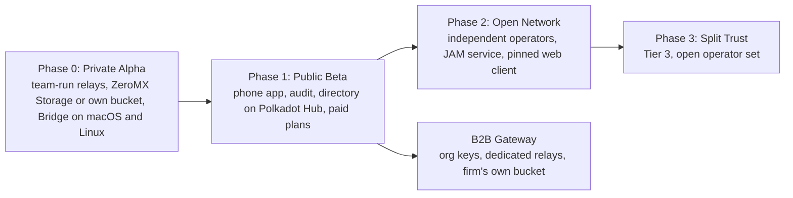

# 04 — Product & Engineering Roadmap

## Principles

1. **Ship the smallest honest product first.** One relay set run by the ZeroMX team and labeled as such, two storage options, and one client: ZeroMX Bridge on a computer.
2. **Each phase must be useful on its own** and must not depend on anything outside the project's control.
3. **External gates are named, not scheduled.** JAM mainnet, a JAM light client, Levity mainnet, the Polkadot app, Proof of Personhood from third-party apps, app-store review and audits have owners outside this team. Phases that depend on them list the gate instead of a week number.
4. **Decentralization is earned in order:** transparency first, then attestation, then independent operators, then split trust, then an open operator set.
5. **Polkadot is used where it is live.** The directory goes to a Polkadot Hub contract at the beta. Nothing before Phase 2 depends on a Polkadot piece that has no date, and the product never requires the Polkadot app ([08, section 5](08-why-polkadot-jam.md)).

The first plan delivered sealed envelopes into the user's Gmail mailbox and started with a Chrome extension. That design was replaced in November 2026 ([07, section 6.1](07-threat-model-and-limits.md)), and the sequence below follows the new one.

---

## Phase 0 — Private Alpha (about 3 months)

**Week-1 gates (`ZMX-000`).** Three cheap tests run before the full stack is built. Each ends in a written go or no-go.

1. **Mail-app compatibility.** Apple Mail, Outlook, Thunderbird and Spark against a prototype local IMAP/SMTP server. Record which IMAP extensions each app needs, and whether Spark accepts a localhost account at all.
2. **Outbound deliverability.** Client-signed DKIM mail sent from relay IPs reaches the inbox at Gmail and Microsoft.
3. **Accept-after-write.** A relay answers `451` while storage is down, and a real sending server retries and delivers once storage is back.

**Goal:** prove the daily experience on a computer with real mail for a few dozen waitlist users, with honest labeling of what is and is not protected. **The alpha is desktop only. There is no phone app, and invitations say so.**

- **Deliverables:**
  - `zeromx-crypto`: hybrid `HPKE` (X25519 + ML-KEM-768), the sealed file container, Padmé padding, key epochs, sealer signatures.
  - `zeromx-relay` ingress and egress, run by the ZeroMX team in confidential VMs. Attestation is produced and published, and the relay is described to users as **team-operated**. The relay accepts a message only after the storage confirms the write.
  - `zeromx-store`: the storage adapter interface, **ZeroMX Storage**, and the **S3-compatible adapter** for a bucket the user brings, with a write-only relay credential. Per-device sealed state logs and the merge rule.
  - **ZeroMX Bridge for macOS and Linux:** a local IMAP/SMTP server in front of the local copy, for Apple Mail, Outlook and Thunderbird.
  - **Device keys, pairing and a printed recovery kit.**
  - **Import** from an existing mailbox over IMAP, and **export** to Maildir and mbox.
  - Onboarding verifier for `MX`, `SPF`, `DKIM`, `DMARC`, **MTA-STS**, **DANE**, **TLS-RPT**.
  - **Directory** as a signed append-only log, mirrored to a contract on a Polkadot Hub testnet.
  - **Polkadot Product spike (`ZMX-037`):** written answers to the open questions in [08, section 9](08-why-polkadot-jam.md).
- **Exit criteria:**
  - A user receives a real bank or clinic PDF at `@theirdomain.com`, reads and replies in their desktop mail app, and a raw dump of the storage contains no plaintext, no sender, no subject, and no `Message-ID`.
  - Two computers show the same mailbox state after both were offline and changed it.
  - A relay credential cannot read, list, overwrite or delete anything in the bucket.
  - Outbound mail passes `DKIM` and `DMARC` at Gmail and Microsoft.
  - A user imports an old mailbox and exports the whole mailbox to Maildir with no server involved.

## Phase 1 — Public Beta (about 6 more months)

**Goal:** remove the three biggest objections: "there is nothing on my phone", "why should I trust your relay", and "who controls the directory".

- **Deliverables:**
  - **ZeroMX app** for iOS, then Android, with relay-sealed push previews, read, and reply.
  - **Bridge for Windows.**
  - **Local search with Gmail-style operators** (`from:`, `to:`, `subject:`, `has:attachment`, `filename:`, `before:`/`after:`, `larger:`, `label:`, `is:unread`, `OR`, `-`, quoted phrases), and **`zeromx-mcp`**. Optional on-device semantic search follows when it is ready, not as a launch item.
  - **Reproducible relay image** and per-message relay verification, shown in the clients.
  - **Directory contract on Polkadot Hub mainnet.** Clients verify it through a light client where contract-storage proofs are available, otherwise through two independent RPC endpoints that must agree.
  - **Paid plans** by card, and in dotUSD if it is live.
  - **Domain registration inside onboarding**, in the user's name.
  - **Per-sender aliases.**
  - **ZeroMX Product in the Polkadot hosts**, if the spike passed.
  - **Free tier for verified people**, if Proof of Personhood is usable from our apps.
- **External gates:**
  - **Independent audit** of the crypto library, the relay image, the Bridge and the app. The report is published before the beta opens.
  - **App-store review** for the phone app.
  - **dotUSD availability**, for the dotUSD payment option only.
  - **Proof of Personhood from a third-party app**, for the free tier only.
- **Exit criteria:** 1,000 active domains. Inbound loss rate and outbound inbox placement measured and published. No open high-severity audit findings.

## Phase 2 — Open Network

**Goal:** more than one party runs relays, and users choose among them.

- **Deliverables:**
  - **Vetted independent operators** with DOT bonds, attestation-of-location and a public list. **Users choose their relays.**
  - **`zeromx-directory` as a JAM service:** key directory, operator registry, and quote verification in `Refine`.
  - **Pinned web client**, shipped only where the code is pinned ([02, section 5.6](02-technical-specification.md)).
  - **Optional storage adapters, only if demand is shown:** an existing IMAP mailbox ([02, section 2.7](02-technical-specification.md)) and the Levity arrival box (`ZMX-038`).
  - **Optional stake-to-use** through a nomination pool.
- **External gates:**
  - **JAM mainnet**, and **a JAM light client usable from an application**, for the JAM service. Until both exist the directory stays on the Polkadot Hub contract, and the product makes no RPC-free claim for JAM.
  - **Levity mainnet**, for the Levity adapter only.
- **Exit criteria:** at least 5 independent operators in at least 3 jurisdictions. Any user domain can list 3 operators with no two under common control.

## Phase 3 — Split Trust & Open Operator Set

**Goal:** no single machine, operator, or CPU vendor holds an outside sender's plaintext.

- **Deliverables:**
  - **Tier-3 ingress (`2PC-TLS`)** across Intel TDX and AMD SEV-SNP operator pairs.
  - `RLN` anonymous rate limiting and on-chain abuse proofs.
  - Permissionless operator registration, enabled only for Tier-3 pairs.

## B2B Gateway (parallel track, starts after the Phase 1 audit)

- Organization-held keys with audited access, encrypted journaling, legal hold and eDiscovery export.
- Dedicated single-tenant relays with jurisdiction pinning.
- **Storage is the firm's own bucket in a chosen jurisdiction.**
- Admin console, deployment of the Bridge and the phone app through MDM.
- Compliance documentation (`GDPR`, `LGPD`, `HIPAA`).

---

## Top Risks

| Risk | Phase | Response |
| :--- | :--- | :--- |
| People will not move to a new mailbox, even with the same address and mail app | 0 | Measured before building, by the validation plan ([09](09-validation-and-launch-plan.md)). Import is a Phase 0 deliverable, not an afterthought. If consumer pull is weak and firms commit, the B2B gateway moves first. |
| A target mail app refuses a local IMAP account or loses features with one. Spark routes accounts through its own servers | 0 | Week-1 gate (`ZMX-000`). Apple Mail, Outlook and Thunderbird are the supported targets. Spark is listed as supported only if the test passes, and the site says "under test" until then. |
| Many target users read mail only in a browser tab | 0 | The waitlist asks where people read mail. Any free desktop mail app works through the Bridge. If the share is high, the pinned web client moves ahead of other Phase 2 items. |
| No phone app in the alpha, and "a separate app" on the phone afterwards | 0–1 | Stated in the invitation and on the site. Alpha invites go first to people who read mail on a computer. The phone app is the first Phase 1 deliverable. |
| Shared outbound IPs get blocklisted, or new relay IPs land in spam | 0+ | Week-1 gate (`ZMX-000`). Paid, staked or verified accounts only, per-account quotas, fast revocation, separate pools for new accounts. |
| Storage outage longer than the sender's retry window bounces mail | 0+ | ZeroMX Storage is run for availability. A directory record may list a second storage target, and onboarding recommends one for a bucket on a home server. Fault injection in CI ([05](05-development-plan.md)). |
| Client release channel is a single point of compromise | 1 | Reproducible builds, two-party release signing, delayed updates with public diff. |
| App-store rejection or removal of the phone app | 1 | The Bridge and the account do not depend on it. Android builds are also distributed outside the store. |
| Confidential-VM hardware break | 1+ | Team-run then vetted operators, fast measurement revocation, Tier 3. |
| A Polkadot piece slips or changes: JAM, Levity, the Polkadot app, Proof of Personhood | 1–2 | Phases 0 and 1 use only Polkadot Hub contracts, which are live. Each other piece gates one optional feature. The directory has a second adapter that runs in CI, so the platform can be left ([08, section 5](08-why-polkadot-jam.md)). |
| The user loses every device and the recovery kit | 0+ | Stated at onboarding. Optional third share held by a person or service the user chooses. Nobody, including ZeroMX, can recover the mailbox otherwise. |
