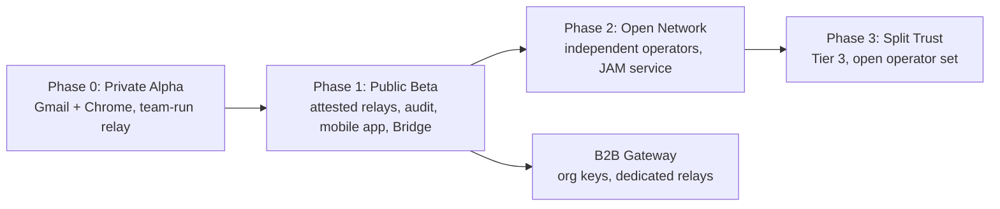

# 04 — Product & Engineering Roadmap

## Principles

1. **Ship the smallest honest product first.** One vault (Gmail), one browser (desktop Chrome), relays run by the ZeroMX team and labeled as such.
2. **Each phase must be useful on its own** and must not depend on anything outside the project's control.
3. **External gates are named, not scheduled.** JAM mainnet, a JAM light client, provider API verification, and audits have owners outside this team. Phases that depend on them list the gate instead of a week number.
4. **Decentralization is earned in order:** transparency first, then attestation, then independent operators, then split trust, then an open operator set.

The original plan put attested relays, an on-chain verifier, zero-knowledge anti-spam, two webmail adapters, a mobile app, an audit, and mainnet into 26 weeks. That was not credible for any team size and is replaced by the sequence below.

---

## Phase 0 — Private Alpha (about 3 months)

**Week-1 Go/No-Go Gate (`ZMX-000`):** Before building the extension or full relay stack, send 500–1,000 realistic Padmé-padded sealed MIME envelopes through an authenticated relay domain into live personal Gmail and Google Workspace accounts and measure spam-folder placement in Google Postmaster Tools. Confirm >99.5% inbox delivery (or lock in the IMAP-append fallback) before proceeding.

**Goal:** prove the daily experience with real mail for a few dozen waitlist users, with honest labeling of what is and is not protected.

- **Deliverables:**
  - `zeromx-crypto` (Rust/Wasm): hybrid `HPKE` (X25519 + ML-KEM-768), `RFC 9788` protected headers, pseudonymized `Message-ID`/`References`, thread tokens, Padmé padding, envelope signatures.
  - `zeromx-relay` ingress and egress, run by the ZeroMX team in confidential VMs. Attestation is produced and published but the relay is described to users as **team-operated**.
  - Chrome extension for **Gmail web**: inline decryption in an isolated extension frame, isolated composer, client-side DKIM, sent-to-self copies. **No Gmail API permission.**
  - Passkey (`WebAuthn PRF`) key derivation and printable recovery kit.
  - Onboarding verifier for `MX`, `SPF`, `DKIM`, `DMARC`, **MTA-STS**, **DANE**, **TLS-RPT**.
  - Key directory as a public append-only log (single operator, no witnesses yet).
- **Exit criteria:**
  - A user receives a real bank or clinic PDF at `@theirdomain.com`, reads and replies inside Gmail, and a raw export of the mailbox contains no plaintext, no real sender, no real subject, and no real `Message-ID`.
  - A 10-message thread groups correctly in Gmail.
  - Network capture shows no draft keystrokes leaving for the provider.
  - Outbound mail passes `DKIM` and `DMARC` at Gmail and Microsoft.

## Phase 1 — Public Beta (about 6 more months)

**Goal:** remove the three biggest objections: "the phone is broken", "I don't use Gmail in a browser", and "why should I trust your relay".

- **Deliverables:**
  - **Native mobile app** (iOS first) with relay-sealed push previews, read, and reply.
  - **ZeroMX Bridge** (macOS first, then Windows and Linux): a local IMAP/SMTP proxy that reads the vault over IMAP, decrypts with the user's key, and serves plain mail to Apple Mail, Spark, Outlook or Thunderbird on `127.0.0.1`. Each computer runs its own Bridge and builds its own index from the mailbox, so no index sync is needed on desktop. See [02, section 4.4](02-technical-specification.md). This was a Phase 3 item. Early feedback from people who read mail in a desktop app moved it here.
  - **Witnessed transparency log** for keys, operators, and the measurement allowlist, anchored to Polkadot.
  - **Reproducible relay image** and client-side attestation verification, shown in the UI per message.
  - **Local search** (`SQLite FTS5`) over rendered and newly received mail, with **Gmail-style operators** (`from:`, `to:`, `subject:`, `has:attachment`, `filename:`, `before:`/`after:`, `larger:`, `label:`, `is:unread`, `OR`, `-`, quoted phrases), and **`zeromx-mcp`**. Optional on-device semantic search follows when it is ready, not as a launch item.
  - Per-sender aliases and one-click `.ics` handling.
  - Domain registration inside onboarding.
  - Paid plans.
- **External gates:**
  - **Independent audit** of the extension, crypto library, and relay image. Public beta does not open before the report is published.
  - **Gmail API verification and security assessment**, only if full-archive indexing ships in this phase, or if the Bridge signs in with OAuth instead of an app password.
- **Exit criteria:** 1,000 active domains. Inbound loss rate and outbound inbox-placement measured and published. No open high-severity audit findings.

## Phase 2 — Open Network

**Goal:** more than one party runs relays, and the control plane moves on-chain.

- **Deliverables:**
  - Operator admission process with attestation-of-location, public operator list, bonds.
  - `zeromx-jam-service`: key directory, operator registry, and quote verification in `Refine`.
  - Optional bridge before JAM: the same verifier crate as a PVM contract on Polkadot Hub, readable through Smoldot today, if the benchmarks in `ZMX-033` pass. See [08](08-why-polkadot-jam.md).
  - Outlook web adapter. Firefox port.
  - Optional Stake-to-Use through a nomination pool.
- **External gates:**
  - **JAM mainnet.**
  - **A JAM light client usable in a browser extension.** Until it exists, clients cross-check two RPC endpoints against witness-signed roots, and the product does not claim RPC-free verification.
- **Exit criteria:** at least 5 independent operators in at least 3 jurisdictions. Any user domain can list 3 operators with no two under common control.

## Phase 3 — Split Trust & Open Operator Set

**Goal:** no single machine, operator, or CPU vendor holds a legacy message's plaintext.

- **Deliverables:**
  - **Tier-3 ingress (`2PC-TLS`)** across Intel TDX and AMD SEV-SNP operator pairs.
  - `RLN` anonymous rate limiting and on-chain abuse proofs.
  - Permissionless operator registration, enabled only for Tier-3 pairs.

## B2B Gateway (parallel track, starts after the Phase 1 audit)

- Organization-held keys with audited access, encrypted journaling, legal hold and eDiscovery export.
- Dedicated single-tenant relays with jurisdiction pinning.
- Admin console, policy deployment through Chrome Enterprise and MDM.
- Compliance documentation (`GDPR`, `LGPD`, `HIPAA`).

---

## Top Risks

| Risk | Phase | Response |
| :--- | :--- | :--- |
| Gmail spam-folders or throttles sealed envelopes from relay addresses | 0 | Measure in the first week of alpha. Per-user allow filter in onboarding. Dedicated sending domains with full authentication. If unsolvable, switch delivery to IMAP append with the user's own credentials. |
| Webmail markup changes break the extension | 0+ | Minimal DOM surface, nightly canary against live accounts, standalone reader tab in the extension. The Bridge does not depend on webmail markup at all. |
| Many target users read mail in a desktop app, not in a browser | 0 | The waitlist asks which app people read mail in. The Bridge ships in Phase 1. If the share is high, the Bridge moves ahead of the Outlook web adapter. |
| Google ends app passwords for IMAP | 1 | The Bridge also supports OAuth, which needs Google's restricted-scope verification and yearly assessment. Budget it as soon as the Bridge is committed to. |
| Extension update channel is a single point of compromise | 1 | Reproducible builds, two-party release signing, delayed updates with public diff. |
| Confidential-VM hardware break | 1+ | Team-run then vetted operators, fast measurement revocation, Tier 3. |
| JAM mainnet or light client slips | 2 | Phases 0 and 1 do not depend on either. The Polkadot Hub bridge step is the fallback. JAM light clients are being built by other teams, and ZeroMX adopts one when it is ready. |
| Shared outbound IPs get blocklisted | 1+ | Paid or staked accounts only, per-account quotas, fast revocation, separate pools for new accounts. |
| The mobile app is "a second app" and users reject it | 1 | State it up front. Offer a per-sender policy that leaves low-sensitivity mail unsealed so it stays readable in the provider's app. |
