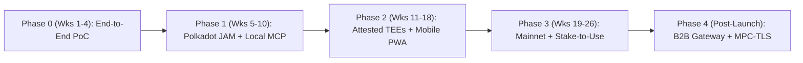

# 04 — Product & Engineering Roadmap

## Overview Timeline

---

## Phase 0 — End-to-End Functional Prototype (Weeks 1–4)

**Goal:** Prove the complete user journey inside real Gmail and Outlook Web using a custom domain, validating zero-friction UX before introducing hardware enclave complexity.

- **Deliverables:**
  - `zeromx-crypto` Rust/Wasm library implementing `HPKE (X25519 + ChaCha20Poly1305)` + `RFC 9788` Protected Headers + deterministic `🔒 Thread #<token>` subject generation + bucket padding.
  - Standalone `zeromx-relay` prototype (Dockerized Rust SMTP ingress + egress) terminating TLS, running in-RAM `SPF`/`DKIM` check, sealing payloads, and forwarding to Gmail/Outlook.
  - Chrome/Brave Manifest V3 Extension v0.1 supporting Gmail Web & Outlook Web:
    - Inline real-time decryption of sender, subject, body, and attachments.
    - Isolated Shadow DOM Reply/Compose drawer blocking native cloud draft auto-saves.
- **Exit Criteria:** A test user points `@testdomain.com` to the relay, receives a real bank/hospital PDF inside Gmail, reads and replies inside Gmail, and confirms via raw Google Takeout / API inspection that Google holds 0 bytes of plaintext.

---

## Phase 1 — Polkadot JAM Testnet, Passkeys & Local MCP (Weeks 5–10)

**Goal:** Remove central key/routing servers via a Polkadot JAM Service and turn local decryption into a superpower with instant offline search and sovereign AI.

- **Deliverables:**
  - `zeromx-jam-service` (Rust compiled to PVM RISC-V): append-only Key Transparency directory (`PublishDomainKey`), operator registry skeleton, and vault anti-rollback roots.
  - Embedded **`Smoldot`** Wasm light client inside the browser extension verifying key records directly over P2P (zero centralized RPC).
  - Native `ZeroMX <-> ZeroMX` automatic client-side E2EE upgrade when recipient domain is found in JAM state.
  - **Passkey (`WebAuthn PRF`)** key derivation + printable 2-of-3 recovery kit.
  - Local encrypted **`SQLite Wasm` (`FTS5`)** search engine overriding/augmenting webmail search + encrypted delta sync to `_zeromx_index`.
  - **`zeromx-mcp` v1.0:** Local MCP server letting Claude Desktop, Cursor, and local agents search and summarize decrypted emails privately.
- **Exit Criteria:** Sub-10ms local search across 10,000 encrypted emails; working Claude Desktop MCP demo querying encrypted Gmail inbox locally.

---

## Phase 2 — Attested TEE Relays, ZK Anti-Spam & Mobile Companion (Weeks 11–18)

**Goal:** Eliminate trust in relay operators via silicon attestation on JAM and solve the #1 UX gap (mobile push notifications & reading on the go).

- **Deliverables:**
  - Reproducible Nix builds for `zeromx-relay` targeting **AMD SEV-SNP** and **Intel TDX** confidential VMs with in-enclave ACME TLS key generation and `mlockall` memory isolation.
  - On-chain `AMD SEV-SNP` / `Intel TDX` quote verifier implemented in `no_std` Rust inside JAM `Refine` (PVM).
  - Zero-Knowledge **Rate-Limiting Nullifier (`RLN`)** circuit + PVM verifier protecting high-reputation Egress SMTP IPs from spam abuse.
  - **Mobile Passkey Companion (iOS/Android PWA + Native Wrapper):** Local background push decryption via FaceID/TouchID so mobile notifications display real sender/subject privately.
  - **UX Polish Pack:** 1-click `.ics` Google/Outlook Calendar invite injector + pre-encryption `Rspamd` spam header tagging.
- **Exit Criteria:** 5+ independent external node operators running attested SEV-SNP/TDX relays on testnet; mobile read/reply flow under 2 seconds via FaceID.

---

## Phase 3 — Mainnet Launch, "Stake-to-Use" & Vault Sweeper (Weeks 19–26)

**Goal:** Public production launch with sustainable DePIN economics, third-party security audit, and legacy inbox migration tools.

- **Deliverables:**
  - Independent cryptographic & extension security audit (cure53 / Trail of Bits profile) covering DOM isolation, WebAuthn key derivation, and enclave build reproducibility.
  - **DOT Stake-to-Use Vault** on Polkadot JAM + Stripe `$1.99/mo` fiat bridge for non-crypto users.
  - **3-Minute Onboarding Wizard:** Automated Cloudflare DNS Connect (`MX` + `SPF` + `DKIM` 1-click setup).
  - **Legacy Vault Sweeper:** Background local tool that retroactively encrypts historical plaintext emails sitting in legacy `@gmail.com` / `@outlook.com` folders and purges plaintext originals.
  - Firefox & Safari WebExtension ports.
- **Exit Criteria:** Public mainnet launch; 1,000+ active custom domains; >99.95% inbound/outbound SMTP deliverability score on Gmail & Microsoft Postmaster Tools.

---

## Phase 4 — Enterprise B2B Gateway & Paranoid Split MPC-TLS (Post-Launch)

**Goal:** Unlock high-ARPU B2B compliance deployments and eliminate single-vendor CPU trust for high-risk users.

- **Deliverables:**
  - **B2B Workspace / M365 Admin Console:** Domain-wide Google Workspace / Entra ID policy provisioning, geo-fenced enclave selection (EU / BR / CH), and compliance audit proofs (`GDPR`, `LGPD`, `HIPAA`).
  - **Tier-3 Paranoid Ingress (`Split 2PC-TLS`):** Multi-party TLS termination across heterogeneous Intel TDX + AMD SEV-SNP operator pairs.
  - Default switch to hybrid post-quantum `X25519MLKEM768` across all clients and relays.
  - Optional standalone local-first desktop/mobile unified client (IMAP/JMAP) for users who want zero reliance on Big Tech webmail DOMs.
